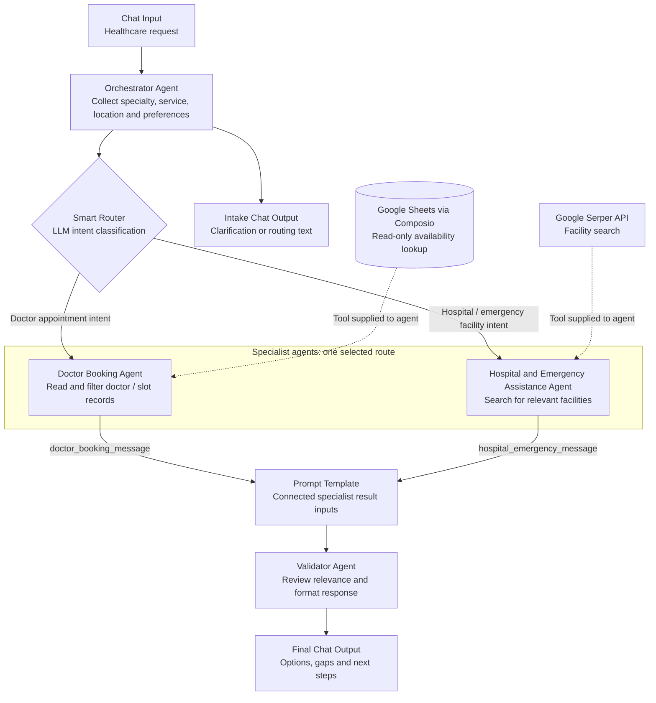

<!-- agent:brain -->
<!-- Commit convention: Conventional Commits with agent scope -->
<!-- Format: type(agent:brain): description -->
<!-- Tags: semantic versioning (v0.1.0, v1.0.0) -->
<!-- Branch: main (PRs for all changes) -->

# Langflow Projects

Reusable Langflow flow exports and project documentation by Swaroop Raj. The idea is to keep one master repository for Langflow-related artifacts, with each project carrying its own flow files, setup instructions, architecture notes, and known limitations.

Configure credentials and resource identifiers in your own Langflow instance before running any flow. These are learning and reference implementations, not production-certified applications.

## Project catalog

| Project | Artifacts | Pattern | Status |
| --- | --- | --- | --- |
| [Doctor Appointment Orchestrator Agent](projects/doctor-appointment-orchestrator/) | `doctor-appointment-orchestrator.json`, project `README.md` | Intake coordinator, LLM intent routing, tool-enabled specialists, validation and presentation | Static review complete; configuration and routing issues documented; live execution not verified |

## Repository structure

```text
README.md
projects/
  doctor-appointment-orchestrator/
    README.md
    doctor-appointment-orchestrator.json
  <future-project>/
    README.md
    <flow-name>.json
```

The catalog is the starting point. Each project README is the source for its dependencies, import instructions, execution path, configuration, and limitations. Keep project-specific detail in that folder rather than expanding the master README indefinitely.

## Getting started

1. Select a project from the catalog and read its README before importing the JSON.
2. Start with the Langflow version recorded in that export. Check component compatibility before trying other versions.
3. Import the flow into your own instance and reconnect provider credentials using managed secrets or environment-backed configuration.
4. Replace resource placeholders, review tool permissions, and use synthetic data for initial testing.
5. Test the documented paths and failure cases. A valid JSON export does not establish that the flow works end to end.

## First project: Doctor Appointment Orchestrator Agent

This flow explores healthcare service discovery through specialist agents. An intake agent collects the request, a Smart Router selects either a doctor-slot lookup specialist or a hospital-search specialist, and a final agent reviews and formats the results.

The doctor path reads a Google Sheet through Composio. The hospital path searches through Google Serper. Four agents use `openai/gpt-4o` through OpenRouter, while routing uses `openai/gpt-4o-mini`.

The current export is a prototype: it can support information lookup, but has no connected appointment-write or reservation tool. The router's configured output messages also discard the collected request details. See the project README before treating it as runnable.

### Multi-agent orchestration pattern

**Intake coordinator + conditional specialist routing + final review and presentation.**

The diagram follows the exported graph. Solid arrows carry messages, dotted arrows supply tools. The router selects one specialist path, not both in parallel.



| Pattern element | What this implementation demonstrates |
| --- | --- |
| Intake coordination | One entry agent gathers the request and prepares a routing payload |
| Conditional delegation | An LLM router selects a specialist based on intent |
| Tool-grounded specialists | Doctor discovery uses spreadsheet records; facility discovery uses web search |
| Shared presentation stage | Specialist output feeds a prompt template and a final reviewer/presenter |
| Responsibility separation | Intake, classification, retrieval, and presentation are separate components |

This is **not** a supervisor dynamically invoking subordinate agents as tools, a parallel agent swarm, or a reviewer-driven correction loop. The graph has no feedback edge from the validator to the specialists.

**Read the diagram as wiring, not a runtime success claim:**

- The router currently substitutes generic route messages for the full intake payload. Clear those messages in a corrected variant to preserve the request details.
- The intake-to-chat connection does not stop the simultaneous routing connection. Clarification needs an explicit readiness gate.
- Both specialists connect to the shared template, but inactive-branch handling at that convergence still needs runtime testing.
- The validator is an LLM presentation/relevance check, not independent clinical or factual verification. No booking-write capability is connected.

## Adding projects

- Create a descriptive kebab-case folder under `projects/`.
- Include the importable JSON and a project README covering purpose, architecture, configuration, test cases, and known gaps.
- Add optional fixtures, screenshots, or supporting documents within the same folder when needed.
- Update the master catalog whenever a project or artifact is added.
- Keep credentials, private resource identifiers, patient information, logs, and runtime databases out of Git history.
- Preserve a clear distinction between the exported baseline and any corrected variants. Document every behavior-changing edit.

## Contribution conventions

Use a feature branch and pull request for changes. Agent-assisted changes use `agent/brain/<short-description>` branches, the `agent:brain` PR label, and Conventional Commit messages such as `feat(agent:brain): add doctor appointment orchestration flow`. Each README begins with the repository's agent provenance header.

Create release tags only when a release is explicitly requested. Do not infer a license from the source platform or from another repository.

## Verification scope

Documentation is based on static inspection of the supplied JSON, including node settings, connections, prompts, and embedded router implementation. Provider authentication, Langflow import, runtime branch behavior, external data quality, and end-to-end execution have not been tested.

## Reference

Repository organization follows the catalog-and-project-folder approach used in [n8n-workflows](https://github.com/swaroop-raj/n8n-workflows).
