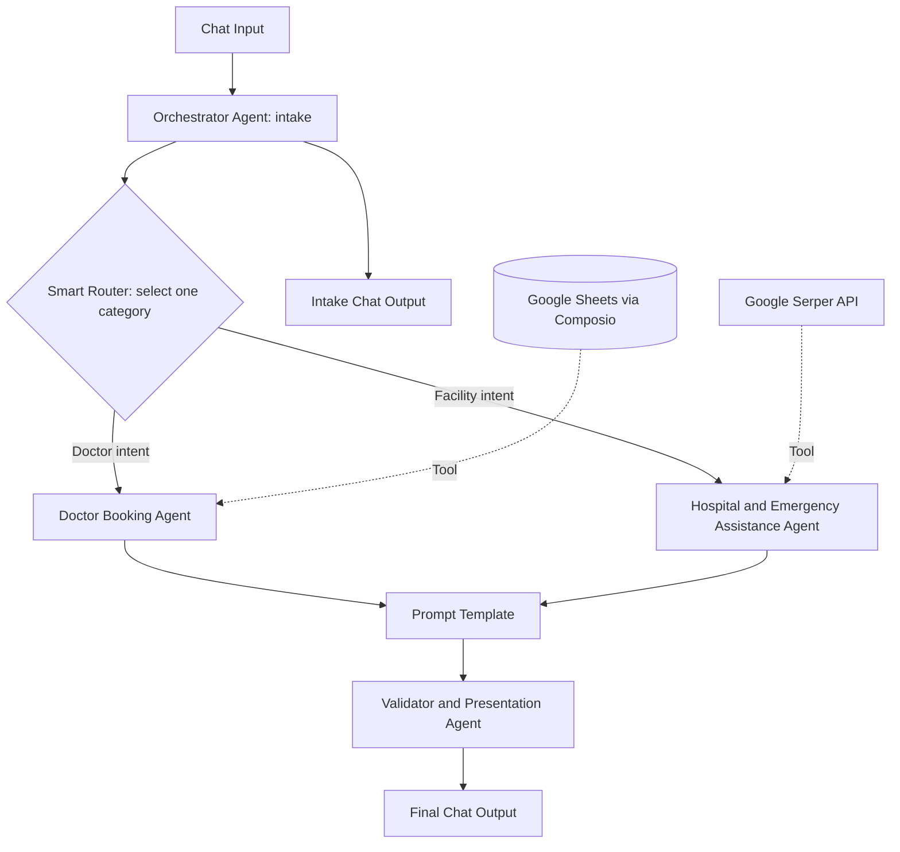

<!-- agent:brain -->
<!-- Commit convention: Conventional Commits with agent scope -->
<!-- Format: type(agent:brain): description -->
<!-- Tags: semantic versioning (v0.1.0, v1.0.0) -->
<!-- Branch: main (PRs for all changes) -->

# Doctor Appointment Orchestrator Agent

A Langflow prototype for routing healthcare discovery requests to specialized agents, retrieving relevant information, and presenting the results through a final validation agent.

The focus is on the orchestration pattern: collect the request once, separate specialist responsibilities, ground responses in tools, and keep presentation in a final stage.

**Current scope:** doctor and appointment-slot lookup from a spreadsheet, plus hospital and emergency-facility search. Despite the agent's name, this export does not create, reserve, or confirm appointments in an external system. It is not a medical diagnosis, clinical triage, or emergency-response service.

**Publication status:** Documentation is checked in. The full sanitized JSON export is still pending upload. The filename below describes the intended artifact, not a file already available in this branch.

## Artifact and review status

| Item | Value |
| --- | --- |
| Planned flow file | `doctor-appointment-orchestrator.json` |
| Original flow title | `Doctor Appointment- Orchestrator Agent` |
| Export's `last_tested_version` | Langflow `1.11.1` |
| Graph | 11 nodes, 11 edges |
| Agents | Intake orchestrator, doctor lookup, hospital search, validator |
| Agent models | `openai/gpt-4o` through OpenRouter |
| Router model | `openai/gpt-4o-mini` through OpenRouter |
| Review performed | Static JSON, graph, prompt, settings, and embedded router-code inspection |
| Not performed | Live import, provider authentication, external tool calls, or end-to-end tests |

The recorded version is export metadata, not an independent compatibility or runtime certification.

## Architecture

Solid arrows carry messages. Dotted arrows supply tools to agents, not a standalone sequence of tool-node execution. Both specialist responses connect to the prompt template, but the Smart Router selects a category rather than intentionally broadcasting to both specialists. Inactive-branch handling at the shared downstream template needs runtime verification.

### Multi-agent pattern

This is a routed specialist pipeline with an intake coordinator and a final reviewer/presenter. It is not a dynamic supervisor invoking subordinate agents as tools. The orchestrator emits a text payload; Langflow edges and the Smart Router control the next stage. There is no cross-agent debate, validator-to-specialist repair loop, or autonomous task-planning loop in the graph.

Each specialist may perform internal model/tool iterations. That local tool-use loop is different from a multi-agent feedback loop. The final validator is another LLM, not a deterministic factual-verification service.

## Component responsibilities

| Component | Responsibility | Important configuration |
| --- | --- | --- |
| Chat Input | Accept user requests | Message storage enabled; saved sample asks for cardiology doctors in Boston |
| Orchestrator Agent | Collect minimum details and emit routing text | Doctor: specialty and location. Facility: service type and location. Patient name and preferred time are optional |
| Smart Router | Classify the intake response | Two categories; Else output disabled; custom output messages configured |
| Doctor Booking Agent | Read and filter doctor/slot records | Composio `GOOGLESHEETS_GET_BATCH_VALUES`; no booking-write action connected |
| Hospital & Emergency Assistance Agent | Search for facilities by location and service | Serper search; configured result count 4 |
| Prompt Template | Place specialist responses into labeled sections | `doctor_booking_message` and `hospital_emergency_message` |
| Validator Agent | Review relevance and present results | No direct original-query edge or independent verification tool |
| Two Chat Outputs | Show intake-stage and final-stage responses | Message storage enabled |

The four agents have a 15-model-call cap, parse/tool-error handling enabled, a history setting of 100 messages, and built-in current-date and calculator tools enabled. Exact history isolation and aggregate model cost require runtime inspection.

## Intended request lifecycle

1. The user submits a request, for example, "Show me available cardiology doctors in Boston."
2. The orchestrator checks for the required details. Its prompt asks for missing information rather than routing an incomplete request.
3. For a complete request, it emits a Markdown-style payload containing target route, routing intent, collected details, a query summary, and downstream instructions.
4. The router selects the doctor or hospital category.
5. The selected specialist calls its attached data tool and returns labeled raw results.
6. The prompt template places specialist messages into doctor and hospital sections.
7. The validator checks relevance from the supplied text, explains gaps, and formats a consumer-facing response.

This is the intended lifecycle. The exported configuration has gaps that prevent treating these steps as verified behavior.

## Export findings and limitations

### 1. Router messages discard the request details

Both routes have nonempty `output_value` fields:

- Doctor: `Route for getting doctor slots and booking doctor appointments`
- Hospital: `Route for hospital and emergency services queries`

The embedded router code returns that configured string in preference to the incoming text. The specialist therefore receives a generic route sentence rather than the orchestrator's collected specialty, location, and preferred slot. Any independently available history does not make this handoff contract reliable.

**Recommended correction:** clear each route's output message to pass through the original input. Verify the specialist's actual input in a fresh session. This is a proposed behavioral change, not a change silently applied to the baseline export.

### 2. Clarification is a prompt instruction, not an enforced routing gate

The orchestrator response is connected to both the Smart Router and a Chat Output. Nothing in the graph explicitly bypasses routing for clarification, small talk, or incomplete requests. The router also has no enabled Else path.

**Recommended correction:** add a structured readiness decision and an explicit clarification/fallback route. Do not rely on "do not route" text alone to stop graph execution.

### 3. The convergence needs a runtime test

Both specialist outputs feed one prompt template, while routing selects one specialist and deactivates nonmatching branches. Static inspection does not establish how this Langflow runtime resolves the inactive input at the shared downstream template.

**Recommended correction:** test both categories independently and inspect whether the prompt template and validator execute. If needed, use a branch-aware merge accepting the selected result or separate finalization paths. Do not describe this as verified parallel aggregation.

### 4. Booking is not implemented

The enabled Sheets action reads values. No reservation write, calendar creation, provider booking API, transaction lock, or confirmation identifier is connected. The validator prompt asks whether the user wants to confirm a slot, but that wording does not implement confirmation.

**Recommended correction:** describe results as availability information only. A real booking extension needs explicit user approval, atomic availability checking, persistence, duplicate prevention, and a verifiable confirmation response.

### 5. Validation is limited by its inputs

The validator receives specialist-result text, not a separately wired original request or authoritative verification source. The handoffs use prompted Markdown, not schema-enforced objects. Search snippets do not establish current emergency capacity or independently verified facility details.

**Recommended correction:** carry the original request, normalized criteria, source URLs, retrieval times, and tool status through a structured contract. Add deterministic checks where appropriate.

### 6. Privacy, safety, and operational controls need hardening

Input and output storage are enabled. Healthcare queries can contain sensitive data, and requests can pass through OpenRouter, a model provider, Composio/Google Sheets, and Serper as applicable. No production privacy compliance has been established by this review.

The export has no explicit immediate-emergency escalation branch. Do not use an LLM facility search as a substitute for emergency services. Add an appropriately reviewed emergency notice and handling policy before any real-world deployment.

The spreadsheet prompt uses an unbounded `A:Z` range. Set a bounded range for larger datasets. Agent retry settings are not a complete operational recovery, monitoring, or alerting design.

## Import and configure

These steps apply once the sanitized JSON artifact is available.

1. Start with a Langflow instance compatible with the export's recorded `1.11.1` version. Confirm availability of the Agent, Smart Router, Prompt Template, Chat Input/Output, Composio Google Sheets, and Google Serper components.
2. Import `doctor-appointment-orchestrator.json`. Review the embedded component code before executing imported components.
3. Configure `OPENROUTER_API_KEY` in your instance. All four agents and the router reference that managed variable. Verify access to the two configured models.
4. Configure your own Composio credential on the Google Sheets component and authenticate the intended Google account through OAuth2. The export's account/entity settings must not be assumed to map to your account.
5. Create or select a synthetic doctor/slot spreadsheet. Replace `REPLACE_WITH_SPREADSHEET_ID` wherever present: the Sheets component, orchestrator prompt, and doctor-agent prompt.
6. Use the tab name `US Healthcare - Doctors & Appointment Slots Mock Data`, or update the doctor-agent range accordingly. The original requested range is `US Healthcare - Doctors & Appointment Slots Mock Data!A:Z`; validate quoting for the tab name and bound the row count for your dataset.
7. Enable only the intended Sheets read action, `GOOGLESHEETS_GET_BATCH_VALUES`, and verify the generated tool name after import. Cached tool metadata includes other actions but is not evidence that they are enabled.
8. Set your Serper API key. This field is empty in the supplied export. Confirm the search tool binding and configured result limit.
9. Review the known issues above, especially router payload preservation and conditional convergence. Implement corrections on a separate branch or clearly named variant.
10. Use fresh sessions and synthetic inputs to test every path before sharing the flow.

No spreadsheet contents or fixture dataset were supplied. A useful synthetic sheet should provide specialty, doctor name, hospital/clinic, city, available slots, and fees/notes. These are prompt expectations, not a verified fixed column schema. Specify timezone and availability semantics in your fixture.

## Test checklist

These are proposed acceptance tests, not reported passes.

| Scenario | Expected behavior / assertion |
| --- | --- |
| Doctor lookup with specialty and city | Correct category, full request preserved, Sheets read invoked, matching rows faithfully presented |
| Missing location | Clarifying question; no specialist tool call |
| Facility search with city and service | Hospital category, targeted search, sourced details only |
| No matching slot | Explicit no-match or clearly labeled alternatives, no invented availability |
| Request to book a slot | No claim of booking completion without a booking-write implementation |
| Sheets authorization or API failure | Transparent failure, no fabricated substitute records |
| Serper missing key or zero results | Distinguish configuration failure from a successful empty search |
| Each route independently | Inactive branch does not block final output or inject stale data |
| Mixed doctor and hospital request | Clarify or explicitly define multi-intent policy; do not assume both branches run |
| Off-topic or adversarial input | Explicit fallback, no unnecessary tools or configuration disclosure |
| New session after another user's request | No previous-user context or result leakage |
| Emergency wording | Immediate safety handling rather than delayed search-only assistance |

Inspect actual node inputs, selected routes, tool arguments, responses, and chat outputs. Record model/tool call counts and latency rather than deriving runtime claims from the canvas screenshot.

## Repository sanitization requirements

The supplied export contains a nonempty literal Composio API-key field and an instance-specific spreadsheet identifier. The repository copy must clear the credential and replace the spreadsheet identifier throughout with `REPLACE_WITH_SPREADSHEET_ID`. Preserve the managed OpenRouter variable reference, embedded component code, node identifiers, graph edges, prompts except resource substitutions, and baseline routing settings. Remove instance-local flow/folder references only where safe for import.

Do not commit the raw attachment. If the Composio value is a valid credential rather than a generated placeholder, rotate it. The actual artifact must be checked against these requirements before publication.

## Next iterations

1. Preserve the routed request, enforce readiness/fallback behavior, and verify convergence.
2. Introduce structured payloads carrying original criteria, source provenance, explicit error states, and freshness.
3. Add synthetic fixtures and repeatable route/failure tests.
4. Add booking writes only as a separate, approved capability with concurrency and confirmation safeguards.
5. Review data retention, session isolation, emergency handling, and observability before deployment.
